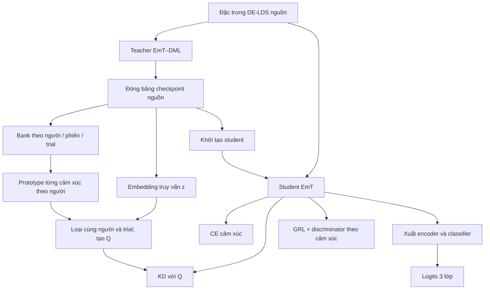

# CSRD-EmT

Framework học biểu diễn cho nhận dạng cảm xúc EEG liên chủ thể, kết hợp **EmT**, **chưng cất tham chiếu liên chủ thể** và **đối kháng có điều kiện theo cảm xúc**.

Triển khai nghiên cứu của **Nguyễn Trường An**, ngành Trí tuệ nhân tạo, Trường Đại học Công nghệ – ĐHQGHN.

## Phương pháp

Hai giai đoạn huấn luyện dùng chung kiến trúc encoder EmT:

1. **Teacher EmT–DML:** học phân loại cảm xúc và metric có thứ tự với multi-proxy. Chọn checkpoint bằng validation nguồn, sau đó đóng băng teacher.
2. **Student CSRD:** khởi tạo encoder và classifier từ teacher; tối ưu CE, KD từ phân bố tham chiếu Q và đối kháng danh tính có điều kiện theo lớp cảm xúc.



Bank lưu centroid embedding 32 chiều theo người–phiên–trial, chỉ từ tập train. Với mẫu của người `s`, trial `t`, Q được tạo bằng cách so embedding teacher với prototype ba cảm xúc của từng người khác `s`, loại trial `t`, rồi trung bình phân bố xác suất giữa các người tham chiếu. Các phiên và trial có trọng số bằng nhau trong prototype.

Student dùng label smoothing 0,1; KD với nhiệt độ 2; GRL chuyển gradient đối kháng về encoder. Ba head danh tính nhận các nhóm mẫu theo nhãn cảm xúc nguồn. Teacher và Q không nhận gradient. Bộ lọc tham chiếu không loại ảnh hưởng của mẫu khỏi trọng số teacher đã học.

Khi suy luận chỉ giữ encoder và cosine classifier của student; không cần teacher, bank, nhãn cảm xúc hay danh tính người mới.

## Dữ liệu và giao thức

| Thành phần | Thiết lập |
|---|---|
| Dataset | SEED, 15 người, ba phiên, ba cảm xúc |
| Đầu vào | DE-LDS đã trích xuất, `[B, 36, 62, 5]` |
| Nhãn | 0: tiêu cực; 1: trung tính; 2: tích cực |
| Cửa sổ | 36 frame, hop 1; không vượt biên trial |
| Mỗi vòng LOSO | 11 người train, ba validation nguồn, một test |
| Chọn checkpoint | BA validation trung bình theo người → CE thấp hơn → bước sớm hơn |
| Optimizer | AdamW, LR `3e-4`, weight decay `0.01` |
| Ngân sách | Tối đa 14.000 bước/giai đoạn; validation mỗi 500; patience 5 |
| Trọng số | Teacher metric `0.1`; student KD `1.0`, GRL `0.1`; warmup 500 |

Người đích bị loại trước khi đọc đặc trưng nguồn; chỉ mở dữ liệu đích sau khi chọn xong checkpoint teacher và student. Không refit trên 14 người. Student được xét cả checkpoint bước 0. Seed teacher là `2022 + target`, seed student là `3022 + target`.

MinMax được fit riêng từng người–phiên về `[-1, 1]`, bao gồm thống kê đặc trưng đích **không nhãn** tại test. Vì vậy, đây không phải chuẩn hóa chỉ fit từ train. SEED đã được sử dụng trong quá trình phát triển phương pháp.

## Cài đặt

Python 3.12 trở lên. Cài PyTorch phù hợp với CPU/CUDA của máy trước, sau đó:

```bash
git clone https://github.com/An-devAI/CSRD-EmT.git
cd CSRD-EmT
python -m venv .venv
source .venv/bin/activate
pip install torch  # Chọn bản CPU/CUDA phù hợp với máy
pip install -e .
```

Đặt dữ liệu SEED đã được cấp quyền ngoài repository. Loader nhận thư mục chứa `label.mat` và 45 tệp MAT đặc trưng, hoặc ZIP có tiền tố `seed/ExtractedFeatures_1s/`. Mỗi trial cần trường `de_LDS1` đến `de_LDS15`; không dùng EEG thô. Hash đặc trưng được kiểm tra với manifest kèm package.

## Huấn luyện và đánh giá

```bash
# Full LOSO, đủ 15 người
python -m csrd_emt train --data /path/to/ExtractedFeatures_1s --output runs/seed --targets all

# Chạy một nhóm người trên thiết bị chỉ định
python -m csrd_emt train --data /path/to/ExtractedFeatures_1s --output runs/subset --targets 1,5,9 --device cuda

# Tiếp tục sau khi gián đoạn
python -m csrd_emt train --data /path/to/ExtractedFeatures_1s --output runs/seed --targets all --resume

# Kiểm tra receipt và tính lại metric từ dự đoán
python -m csrd_emt summarize --output runs/seed
```

Mặc định yêu cầu CUDA; dùng `--device cpu` khi cần. Checkpoint tại mỗi mốc validation lưu model, optimizer, bộ lấy mẫu và RNG. Resume áp dụng cho output của cùng phiên bản mã/cấu hình; checkpoint Kaggle lịch sử không dùng trực tiếp làm checkpoint resume của package.

Mỗi `fold_XX/` chứa checkpoint teacher/student, bank, manifest, lịch sử validation, mô hình suy luận, dự đoán người đích và receipt SHA-256. Kết quả nguồn và kết quả đích có trường riêng. `summary.json` chỉ có trung bình full LOSO khi đủ 15 người hợp lệ; trường trung bình để `null` khi chưa đủ.

## Suy luận

```python
import torch
from csrd_emt import load_student

model = load_student("runs/seed/fold_01/student_inference.pt")
# x: tensor float32 [B, 36, 62, 5], DE-LDS đã chuẩn hóa theo giao thức
with torch.no_grad():
    logits = model(x)
    probabilities = logits.softmax(dim=-1)
    predictions = logits.argmax(dim=-1)
```

Encoder không tự thực hiện chuẩn hóa; thống kê nhóm được lưu riêng trong manifest.

## Kiểm thử và trạng thái

```bash
python -m unittest discover -s tests -v
```

Kiểm thử CPU dùng dữ liệu tổng hợp: tách train/test, tạo Q và bộ lọc tham chiếu, checkpoint/resume, xuất mô hình và tính lại metric. Các số liệu trong kiểm thử không phải kết quả thực nghiệm.

Full LOSO đang được triển khai; chưa công bố kết quả tổng hợp đủ 15 người được kiểm toán. Kết quả validation nguồn trước đó chưa xác nhận ưu thế của framework. SEED-IV chưa được hỗ trợ trong bản này.

## Nguồn kế thừa

Backbone được điều chỉnh từ [EmT](https://github.com/yi-ding-cs/EmT). Metric learning tham khảo [Cross-Subject EEG-Based Emotion Recognition Using Deep Metric Learning and Adversarial Training](https://doi.org/10.1109/ACCESS.2024.3458833). Đóng góp triển khai là quy trình phối hợp teacher–student, tham chiếu prototype có bộ lọc người/trial và đối kháng có điều kiện; không nhận KL, GRL hay metric learning là loss mới.

Mã kế thừa giữ **CBCR License 1.0**, giới hạn sử dụng phi thương mại; xem [LICENSE](LICENSE) và [NOTICE](NOTICE). Dữ liệu SEED không được phân phối cùng mã.
